# CHƯƠNG IV: PHÂN TÍCH VÀ THIẾT KẾ HỆ THỐNG

> **Phạm vi bản thảo:** Nội dung dưới đây được xây dựng theo cấu trúc đề mục trong ảnh người dùng cung cấp, nhưng thay các nghiệp vụ “thành viên/công việc/bình luận” của mẫu bằng nghiệp vụ có thật trong dự án AI Traffic Violation. Các sơ đồ Mermaid có thể dựng lại bằng draw.io, StarUML hoặc PlantUML để chèn vào báo cáo. Cần thay các chỗ `[bổ sung ...]` bằng thông tin triển khai/thực nghiệm thực tế trước khi nộp.

## 4.1. Kiến trúc hệ thống

Hệ thống được thiết kế theo mô hình ứng dụng web gồm giao diện người dùng, máy chủ API, mô-đun trí tuệ nhân tạo và dịch vụ Supabase. Quy trình video có thêm một tiến trình worker chạy nền để xử lý các tác vụ dài mà không giữ kết nối HTTP trong suốt thời gian phân tích.

### Các thành phần chính

| Thành phần | Công nghệ/vai trò | Nhiệm vụ |
|---|---|---|
| Giao diện người dùng | HTML, CSS, JavaScript thuần; được Flask phục vụ | Đăng nhập, gửi ảnh/video, cấu hình vạch dừng, xem dashboard, danh sách video/vi phạm, lịch sử, báo cáo và nhật ký admin. |
| API backend | Python, Flask | Xác thực phiên ứng dụng, kiểm tra quyền, nhận file, gọi detector, lưu dữ liệu, truy xuất thống kê và cấp URL ký tạm cho bằng chứng riêng tư. |
| Bộ phân tích AI | Ultralytics YOLO, OpenCV, EasyOCR | Phát hiện người/phương tiện/đèn giao thông, phát hiện đội mũ bảo hiểm, ghép người với xe máy, suy luận vượt vạch khi đèn đỏ và nhận dạng biển số. |
| Video worker | Python chạy độc lập | Nhận job video đang chờ từ Supabase, tải video, phân tích theo frame, gộp sự kiện gần trùng, lưu kết quả và cập nhật trạng thái/tiến độ. |
| Supabase Auth | Dịch vụ xác thực của Supabase | Lưu thông tin xác thực tài khoản, xử lý đăng ký/đăng nhập và xác minh email nếu được bật. |
| Supabase PostgreSQL | Cơ sở dữ liệu quan hệ | Lưu hồ sơ người dùng, cấu hình camera, video, lịch sử ảnh, vi phạm, nhật ký hoạt động và heartbeat worker. |
| Supabase Storage | Lưu trữ đối tượng riêng tư | Lưu video nguồn, ảnh gốc/ảnh đã đánh dấu, video kết quả và tệp bằng chứng. Backend tạo signed URL có thời hạn để xem tệp. |

### Mô-đun AI và quy trình suy luận

AI là một phần trong kiến trúc xử lý của backend, không phải một dịch vụ độc lập. API gọi bộ phân tích khi nhận ảnh; video worker gọi cùng pipeline cho các frame được chọn. Hệ thống kết hợp mô hình học sâu với xử lý ảnh theo luật, không dùng một mô hình duy nhất để dự đoán trực tiếp tất cả loại vi phạm.

1. **Phát hiện người và phương tiện:** YOLOv8n COCO xác định người, xe máy, ô tô, xe buýt, xe tải và đèn giao thông.
2. **Phát hiện mũ bảo hiểm:** mô hình YOLO tùy chỉnh có hai lớp `With Helmet` và `Without Helmet`.
3. **Ghép người với xe máy:** logic hình học lọc các cặp theo tâm ngang, vị trí dọc, tỷ lệ kích thước và diện tích giao nhau; chọn ghép tham lam theo score. Đây là heuristic, không phải mô hình tracking.
4. **Phát hiện chở quá người:** hệ thống phát sinh sự kiện khi một xe máy được ghép với từ ba người trở lên theo luật hiện tại.
5. **Phát hiện vượt đèn đỏ:** nếu tùy chọn vạch dừng bật, detector tìm vùng đèn giao thông, phân loại màu bằng ngưỡng HSV, so sánh vị trí đáy bounding box phương tiện với đường dừng ngang có vị trí `stop_line_ratio`.
6. **Nhận dạng biển số (ALPR):** cắt vùng dưới của bounding box phương tiện, tiền xử lý ảnh bằng grayscale/CLAHE và dùng EasyOCR với allowlist ký tự; kết quả được chuẩn hóa bằng regex/logic chuỗi. Nếu OCR không khởi tạo hoặc không đọc được, biển số có thể để “Chưa rõ”.
7. **Gộp sự kiện video:** các detection cùng loại trong khoảng thời gian ngắn được gộp khi bounding box giao nhau đủ mức hoặc biển số trùng; lưu frame đầu/cuối và số lần quan sát. Kết quả có thể tách nhầm hoặc gộp nhầm xe.

**Pipeline ảnh:** `Ảnh đầu vào → kiểm tra định dạng → YOLO COCO → YOLO mũ bảo hiểm → liên kết người/xe → tùy chọn đèn đỏ/vạch dừng → OCR có điều kiện → bounding box/nhãn/summary → lưu ảnh chú thích, lịch sử và vi phạm.`

**Pipeline video:** `Video → lưu Storage + record pending → worker claim job → giải mã OpenCV → lấy mẫu frame theo frame_skip → chạy pipeline suy luận ảnh cho từng frame → gắn số frame → gộp sự kiện gần trùng → lưu video chú thích và vi phạm → cập nhật trạng thái/tiến độ.`

**Giới hạn của pipeline AI:** dữ liệu train hiện nêu cụ thể cho lớp mũ bảo hiểm; chưa có bằng chứng về bộ dữ liệu có nhãn riêng cho vượt đèn đỏ/biển số được dùng để huấn luyện trong project. Màu đèn dựa trên HSV trong vùng đèn mà COCO phát hiện được nên có thể bị ảnh hưởng bởi ánh sáng, phản xạ, độ phân giải và góc camera. Vạch dừng hiện là đường ngang theo tỷ lệ chiều cao frame, không phải nhận dạng vạch đường đa hình/phối cảnh. Gán người vào xe dựa trên hình học trong một frame, không duy trì ID phương tiện qua thời gian; gộp video cũng là heuristic IoU/biển số và cửa sổ thời gian, không thay thế multi-object tracking. OCR nhạy với độ phân giải, góc nhìn, rung, ánh sáng và biển số bị che. Vì vậy, kết quả AI là gợi ý sàng lọc; admin/CSGT cần kiểm tra bằng chứng trước khi xác nhận hồ sơ, không dùng riêng kết quả tự động làm căn cứ xử phạt.

### Sơ đồ kiến trúc triển khai

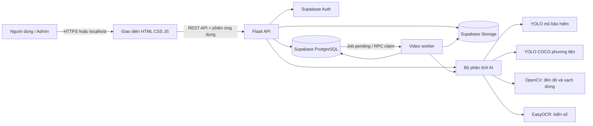

### Luồng dữ liệu khái quát

1. Người dùng đăng nhập bằng tài khoản ứng dụng. Backend xác thực thông tin với Supabase Auth và tạo phiên ứng dụng.
2. Khi phân tích ảnh, trình duyệt gửi ảnh tới API. API gọi detector, nhận ảnh đã chú thích và danh sách phát hiện, sau đó lưu tệp, lịch sử phân tích và các vi phạm liên quan.
3. Khi phân tích video, API lưu tệp vào Storage và tạo bản ghi video trạng thái `pending`. Worker độc lập nhận job, cập nhật tiến độ, chạy detector, gộp các phát hiện gần trùng và cập nhật trạng thái cuối cùng.
4. Người dùng xem danh sách, biểu đồ và hồ sơ. Tệp trong bucket riêng tư được truy cập qua signed URL có thời hạn; vai trò admin có thêm quyền quản trị và duyệt kết quả.

Phiên ứng dụng hiện được giữ trong bộ nhớ backend. Do đó, sau khi khởi động lại API, người dùng cần đăng nhập lại. API và worker phải được cấu hình cùng project Supabase; khóa service-role chỉ sử dụng ở backend/worker, không gửi xuống trình duyệt.

## 4.2. Biểu đồ Use Case tổng quan

### 4.2.1. Danh sách tác nhân

| Tác nhân | Mô tả | Quyền/nghiệp vụ chính |
|---|---|---|
| Khách chưa đăng nhập | Người chưa có phiên hợp lệ | Đăng ký tài khoản viewer, đăng nhập, yêu cầu đặt lại mật khẩu, xác minh hoặc gửi lại email xác minh. |
| Người xem (Viewer) | Người dùng đã đăng nhập với role `viewer` | Gửi ảnh/video phân tích; xem dashboard, xu hướng, video, vi phạm, lịch sử ảnh thuộc sở hữu của mình; xem báo cáo bằng chứng và xuất CSV. |
| Quản trị viên (Admin/CSGT) | Người dùng có role `admin` | Thực hiện các nghiệp vụ xem như viewer; xem lịch sử ảnh toàn hệ thống; tạo admin mới; duyệt/cập nhật/xóa vi phạm; xóa video; xem nhật ký hoạt động. |
| Video worker | Tiến trình nền, không phải người dùng giao diện | Nhận job video, cập nhật heartbeat/tiến độ, lưu kết quả phân tích và trạng thái xử lý. |
| Supabase | Hệ thống ngoài cung cấp Auth, PostgreSQL, Storage | Xác thực, lưu/đọc dữ liệu và lưu tệp. |
| Bộ phân tích AI | Thành phần xử lý nội bộ | Trả về bounding box, loại phát hiện, độ tin cậy, biển số nếu đọc được, ảnh/video đã chú thích và dữ liệu tổng hợp. |

**Lưu ý về phân quyền:** Mã nguồn hiện có hai role ứng dụng là `viewer` và `admin`; “CSGT” được thể hiện như vai trò nghiệp vụ của admin, chưa phải role độc lập thứ ba.

### 4.2.2. Biểu đồ Use Case tổng quát

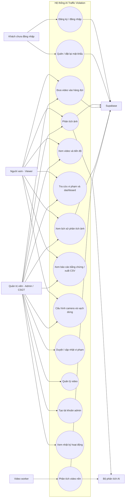

`UC9` đọc và lưu cấu hình camera theo tài khoản và mã camera. Tùy chọn vạch dừng có thể bật/tắt; tọa độ đường dừng được biểu diễn bằng tỷ lệ theo chiều cao ảnh.

## 4.3. Đặc tả Use Case

### 4.3.1. Use Case đăng ký và đăng nhập

| Thuộc tính | Mô tả |
|---|---|
| Mã | UC-01 |
| Tác nhân | Khách chưa đăng nhập; Supabase Auth |
| Mục tiêu | Tạo tài khoản viewer hoặc xác thực người dùng để truy cập hệ thống. |
| Tiền điều kiện | API và Supabase Auth hoạt động; email chưa được sử dụng cho tài khoản khác. |
| Hậu điều kiện | Tài khoản được lưu trong Supabase; khi đăng nhập thành công backend tạo phiên ứng dụng. |

**Luồng chính đăng ký**

1. Khách nhập họ tên, username, email và mật khẩu.
2. Giao diện gửi yêu cầu tới `POST /api/auth/register`.
3. Backend kiểm tra trường bắt buộc, định dạng username và độ dài mật khẩu.
4. Backend gọi Supabase Auth tạo tài khoản. Đăng ký công khai gán role `viewer`.
5. Trigger cơ sở dữ liệu tạo hồ sơ trong `public.user_profiles` và đồng bộ bảng tương thích `public.users`.
6. Nếu Supabase yêu cầu xác minh email, hệ thống thông báo người dùng xác minh trước khi đăng nhập; nếu có session hợp lệ thì backend trả token ứng dụng.

**Luồng chính đăng nhập**

1. Người dùng nhập email và mật khẩu.
2. Giao diện gửi `POST /api/auth/login`.
3. Backend gọi Supabase Auth để xác thực.
4. Backend đọc hồ sơ role từ `user_profiles`, tạo session trong bộ nhớ và trả token cùng thông tin người dùng.
5. Giao diện hiển thị chức năng theo role.

**Luồng ngoại lệ**

- Email/mật khẩu sai hoặc email chưa xác minh: trả thông báo phù hợp, không tạo phiên.
- Username/email trùng khi đăng ký: báo lỗi; không tạo tài khoản thứ hai.
- Lỗi trigger/hồ sơ hoặc Supabase: trả lỗi cho giao diện và ghi log backend.

### 4.3.2. Use Case phân tích ảnh

| Thuộc tính | Mô tả |
|---|---|
| Mã | UC-02 |
| Tác nhân | Viewer/Admin; bộ phân tích AI; Supabase |
| Mục tiêu | Phân tích một ảnh giao thông và lưu ảnh gốc, ảnh chú thích, lịch sử và phát hiện. |
| Tiền điều kiện | Người dùng đã đăng nhập; service-role backend và các bucket riêng tư đã cấu hình; ảnh thuộc định dạng hỗ trợ. |
| Hậu điều kiện | Lịch sử ảnh được lưu; các vi phạm phát hiện được gắn với lịch sử; giao diện nhận kết quả và URL bằng chứng có thời hạn. |

**Luồng chính**

1. Người dùng chọn ảnh, chọn camera và bật/tắt kiểm tra vạch dừng.
2. Trình duyệt gửi multipart request tới `POST /detect/image`.
3. Backend xác thực role, kiểm tra phần mở rộng và tỷ lệ vạch dừng.
4. Detector chạy mô hình YOLO COCO để phát hiện người/phương tiện/đèn giao thông; mô hình mũ bảo hiểm chạy riêng.
5. Hệ thống liên kết người với xe máy theo vị trí hình học, xác định các loại vi phạm hỗ trợ và có thể gọi OCR biển số.
6. Backend lưu ảnh gốc và ảnh đã chú thích vào bucket `violations`.
7. Backend tạo bản ghi `image_analyses`; từng vi phạm được lưu trong `violations` với `image_analysis_id`.
8. Backend ghi audit log nếu ghi log hoạt động thành công, tạo signed URL và trả kết quả.

**Luồng ngoại lệ**

- File sai định dạng, thiếu file hoặc tham số ngoài miền cho phép: trả lỗi đầu vào.
- Không có service-role key: từ chối do không thể lưu lịch sử/bằng chứng riêng tư.
- Detector hoặc Storage/DB lỗi: ghi log; backend cố gắng xóa các tệp/bản ghi dở dang.
- Không phát hiện vi phạm: vẫn lưu lịch sử phân tích và trả summary có số vi phạm bằng 0.

### 4.3.3. Use Case phân tích video

| Thuộc tính | Mô tả |
|---|---|
| Mã | UC-03 |
| Tác nhân | Viewer/Admin; video worker; bộ phân tích AI; Supabase |
| Mục tiêu | Đưa video vào hàng đợi và phân tích nền, theo dõi tiến độ và lưu sự kiện. |
| Tiền điều kiện | Người dùng đã đăng nhập; bucket `videos`, schema video/worker và service-role key hoạt động; worker đã chạy để xử lý job. |
| Hậu điều kiện | Video có trạng thái `processed` hoặc `error`; video kết quả và sự kiện vi phạm được lưu. |

**Luồng chính**

1. Người dùng chọn video, frame skip và thiết lập vạch dừng.
2. Giao diện gửi `POST /detect/video`.
3. API kiểm tra định dạng/kích thước, tải file lên bucket `videos`, tạo record `videos` ở trạng thái `pending`.
4. Worker định kỳ gọi RPC `claim_next_video_job()` để khóa và nhận một job.
5. Worker tải video, đặt trạng thái `processing`, tăng số lần thử và xử lý các frame theo frame skip.
6. Worker cập nhật tiến độ, gia hạn heartbeat và gọi detector trên các frame được chọn.
7. Các phát hiện cùng loại gần nhau được gộp thành sự kiện gần đúng theo khoảng cách frame và IoU bounding box hoặc biển số giống nhau.
8. Worker lưu video chú thích và các record `violations`, sau đó cập nhật video thành `processed`.
9. Giao diện polling trạng thái `GET /videos/<id>` để hiển thị phần trăm và kết quả.

**Luồng ngoại lệ**

- Worker không chạy: video giữ `pending`, chưa có kết quả.
- Tác vụ lỗi: worker ghi lỗi và retry; schema hiện giới hạn tối đa ba lần thử.
- Codec không đọc được hoặc file hỏng: job có thể chuyển `error`; kiểm tra `processing_error`.
- Gộp sự kiện là heuristic, không phải theo dõi danh tính phương tiện liên tục.

### 4.3.4. Use Case duyệt và cập nhật vi phạm

| Thuộc tính | Mô tả |
|---|---|
| Mã | UC-04 |
| Tác nhân | Admin/CSGT |
| Mục tiêu | Kiểm tra bằng chứng, xác nhận/từ chối vi phạm, sửa biển số và thêm ghi chú. |
| Tiền điều kiện | Admin đã đăng nhập; hồ sơ vi phạm tồn tại. |
| Hậu điều kiện | Trạng thái duyệt, biển số/ghi chú và thông tin người duyệt được cập nhật; audit log được ghi. |

**Luồng chính**

1. Admin mở danh sách vi phạm và chọn một hồ sơ.
2. Hệ thống trả chi tiết vi phạm cùng signed URL của ảnh/video bằng chứng.
3. Admin kiểm tra ảnh/video, nhãn, độ tin cậy và biển số.
4. Admin chọn trạng thái `pending`, `approved` hoặc `rejected`, có thể sửa biển số và ghi chú.
5. Giao diện gửi `PATCH /violations/<id>`.
6. Backend xác thực role admin, kiểm tra dữ liệu, cập nhật DB và ghi `audit_logs`.
7. Giao diện hiển thị kết quả cập nhật.

**Luồng ngoại lệ**

- Viewer gọi endpoint cập nhật: backend từ chối theo RBAC.
- Trạng thái không hợp lệ hoặc ghi chú/biển số quá dài: trả lỗi 400.
- Lưu dữ liệu hoặc audit log lỗi: trả lỗi 503 và ghi log.

### 4.3.5. Use Case tra cứu lịch sử, xu hướng và báo cáo

| Thuộc tính | Mô tả |
|---|---|
| Mã | UC-05 |
| Tác nhân | Viewer/Admin; riêng nhật ký hoạt động chỉ Admin |
| Mục tiêu | Tra cứu thống kê, lịch sử, bằng chứng, xuất CSV và nhật ký. |
| Tiền điều kiện | Người dùng đăng nhập; service-role và schema liên quan sẵn sàng cho lịch sử, biểu đồ, signed URL. |
| Hậu điều kiện | Dữ liệu phù hợp quyền sở hữu được hiển thị; không chỉnh sửa dữ liệu khi chỉ xem. |

**Luồng chính**

1. Người dùng mở dashboard hoặc trang lịch sử.
2. Backend kiểm tra token và role.
3. Viewer chỉ truy vấn lịch sử ảnh do mình sở hữu; admin có thể xem lịch sử toàn hệ thống.
4. Dashboard tải số lượng video/vi phạm; biểu đồ gọi RPC `violation_trends` với khoảng ngày và bucket ngày/tuần.
5. Người dùng mở báo cáo vi phạm để lấy signed URL ảnh/video; hoặc xuất CSV.
6. Admin có thể mở trang nhật ký, lọc theo hành động và khoảng ngày.

**Luồng ngoại lệ**

- Khoảng ngày sai/đảo ngược hoặc loại bucket không hỗ trợ: trả lỗi đầu vào.
- Viewer truy cập nhật ký admin hoặc lịch sử ảnh người khác: bị từ chối.
- Signed URL hết hạn: giao diện cần yêu cầu URL mới từ backend.

## 4.4. Biểu đồ hoạt động

### 4.4.1. Biểu đồ hoạt động đăng ký/đăng nhập

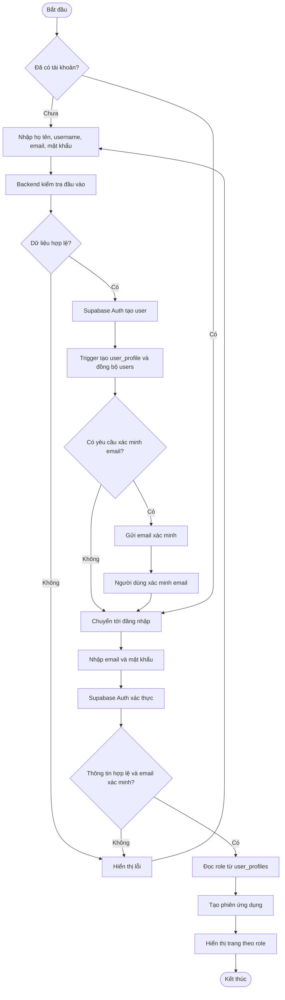

### 4.4.2. Biểu đồ hoạt động phân tích ảnh

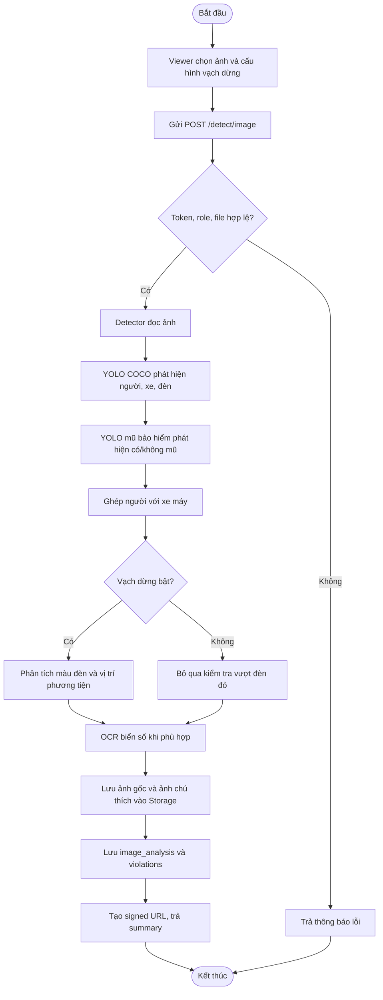

### 4.4.3. Biểu đồ hoạt động xử lý video nền

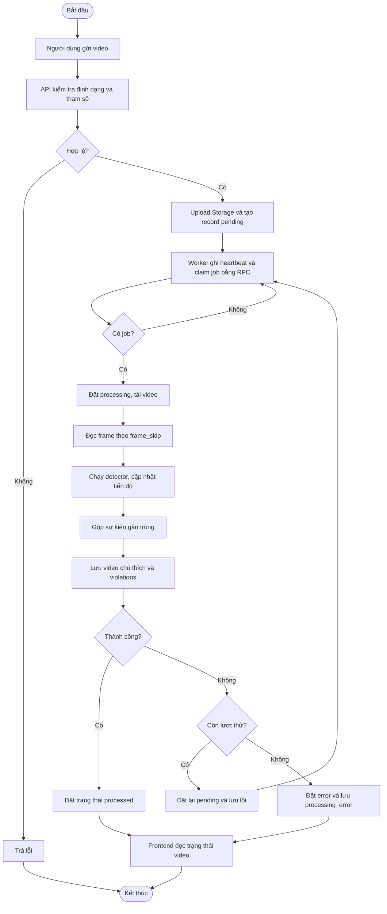

### 4.4.4. Biểu đồ hoạt động duyệt vi phạm

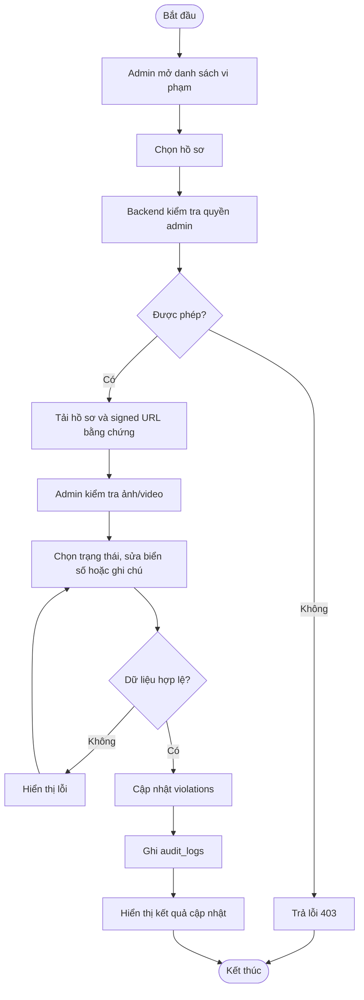

## 4.5. Biểu đồ tuần tự

### 4.5.1. Biểu đồ tuần tự đăng ký/đăng nhập

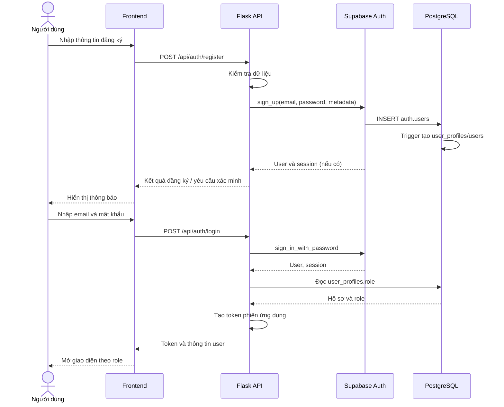

### 4.5.2. Biểu đồ tuần tự phân tích ảnh

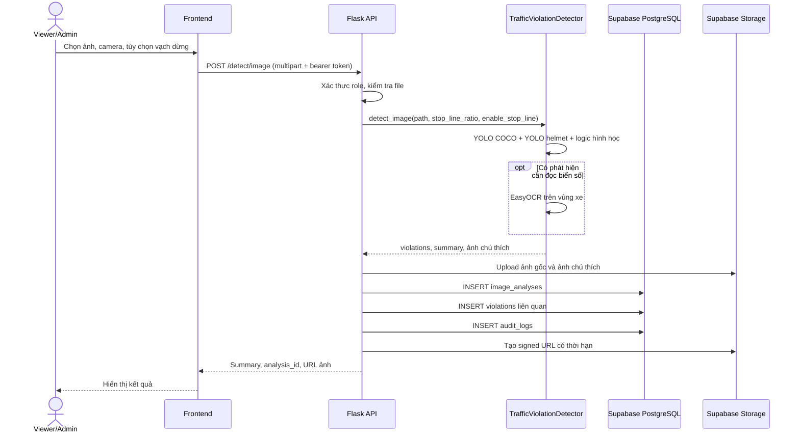

### 4.5.3. Biểu đồ tuần tự phân tích video

```mermaid
sequenceDiagram
    actor U as Viewer/Admin
    participant UI as Frontend
    participant API as Flask API
    participant S as Supabase Storage
    participant DB as PostgreSQL
    participant W as Video worker
    participant AI as TrafficViolationDetector

    U->>UI: Chọn video và thiết lập
    UI->>API: POST /detect/video
    API->>S: Upload video nguồn
    API->>DB: INSERT videos(status=pending)
    API-->>UI: 202 + video_id
    loop Poll trạng thái
        UI->>API: GET /videos/{id}
        API->>DB: SELECT trạng thái/tiến độ
        DB-->>API: pending/processing/processed/error
        API-->>UI: Trạng thái và tiến độ
    end
    W->>DB: RPC claim_next_video_job()
    DB-->>W: Job đã claim
    W->>S: Download video
    W->>AI: detect_video(frames, frame_skip, options)
    AI-->>W: Frame đã chú thích và detections
    W->>DB: Update progress/heartbeat
    W->>W: Gộp sự kiện gần trùng
    W->>S: Upload video kết quả
    W->>DB: INSERT violations; UPDATE videos=processed
    UI-->>U: Hiển thị kết quả hoàn tất
```

### 4.5.4. Biểu đồ tuần tự duyệt vi phạm

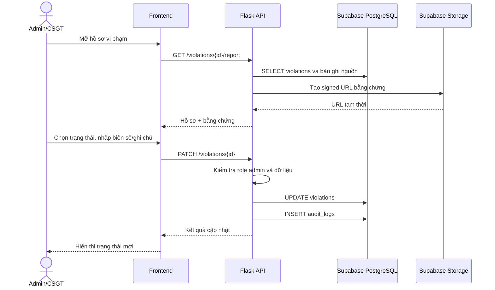

### 4.5.5. Biểu đồ tuần tự xem lịch sử/xu hướng

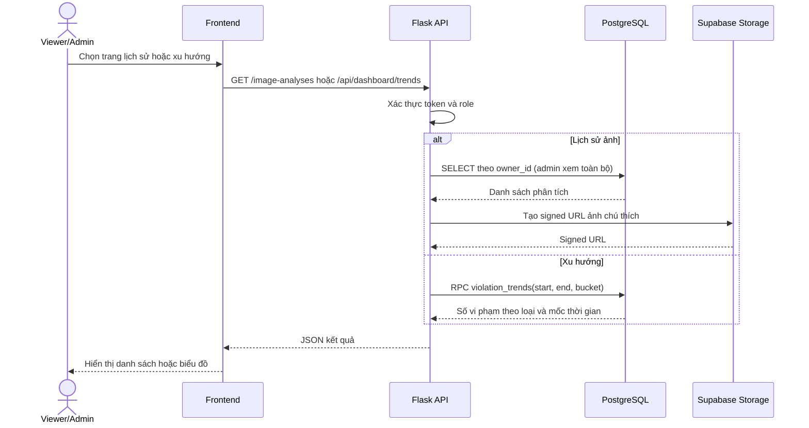

## 4.6. Cơ sở dữ liệu của hệ thống

Hệ thống sử dụng Supabase PostgreSQL. Supabase Auth quản lý thông tin xác thực; các bảng `user_profiles` và `users` chứa thông tin hồ sơ/role ứng dụng. Tệp gốc, tệp chú thích và video được lưu trong Storage riêng tư; cơ sở dữ liệu lưu metadata và đường dẫn.

### Sơ đồ quan hệ dữ liệu

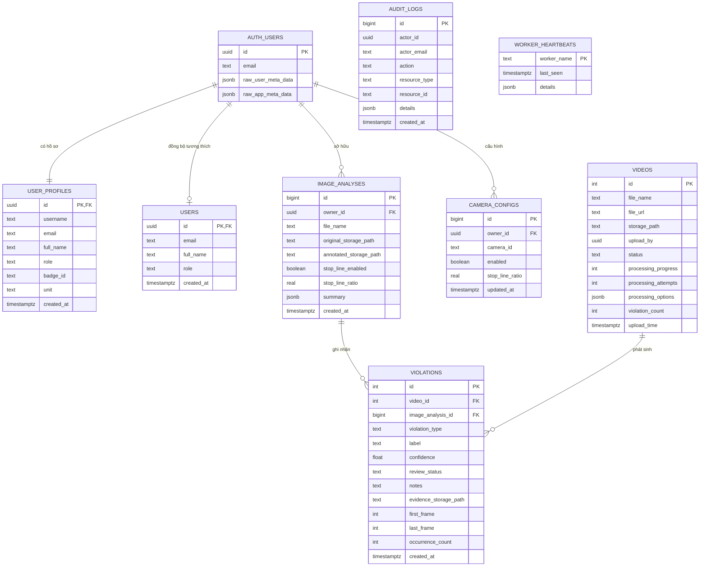

### Mô tả các bảng

| Bảng | Vai trò | Quan hệ/ghi chú |
|---|---|---|
| `auth.users` | Bảng xác thực do Supabase quản lý | Lưu tài khoản đăng nhập và metadata. Không sửa trực tiếp thay cho API Auth thông thường. |
| `user_profiles` | Hồ sơ chính của ứng dụng | `id` tham chiếu `auth.users`; lưu username, email, họ tên, role, mã badge và đơn vị. Trigger tạo profile khi có user mới. |
| `users` | Bảng tương thích với phiên bản/logic cũ | Được trigger đồng bộ từ Auth; không phải bản sao mật khẩu. |
| `image_analyses` | Một lần phân tích ảnh | Gắn owner, tên file, đường dẫn ảnh gốc/chú thích, tùy chọn vạch dừng, summary JSON và thời điểm tạo. |
| `videos` | Video tải lên và trạng thái hàng đợi | Trạng thái `pending`, `processing`, `processed`, `error`; chứa tiến độ, số lần thử, lỗi và tùy chọn xử lý JSON. |
| `violations` | Một kết quả vi phạm | Có thể liên kết tới video hoặc lần phân tích ảnh; lưu loại, nhãn, confidence, vùng box, trạng thái duyệt, ghi chú, biển số trong `extra_data`, bằng chứng và frame sự kiện. |
| `camera_configs` | Cấu hình riêng theo user/camera | Unique theo `(owner_id, camera_id)`; lưu bật/tắt vạch và tỷ lệ vị trí đường dừng. |
| `audit_logs` | Nhật ký thao tác quản trị/nghiệp vụ | Lưu actor, action, loại/id tài nguyên, chi tiết JSON và thời gian. |
| `worker_heartbeats` | Trạng thái tiến trình worker | Mỗi worker có tên, thời điểm heartbeat và metadata vận hành. |

### Ràng buộc và chỉ mục đáng chú ý

- `violations.violation_type` giới hạn trong `no_helmet`, `overloaded_motorcycle`, `red_light`.
- `videos.status` giới hạn trong `pending`, `processing`, `processed`, `error`; tiến độ từ 0 đến 100.
- `camera_configs.stop_line_ratio` và `image_analyses.stop_line_ratio` nằm trong miền 0,30–0,95.
- Khi xóa một video, các vi phạm có `video_id` đó bị xóa theo `ON DELETE CASCADE`; khi xóa lần phân tích ảnh, các vi phạm liên quan cũng cascade.
- Chỉ mục hỗ trợ lọc video theo trạng thái/thời gian, vi phạm theo video/loại/thời gian, lịch sử theo owner/thời gian và liên kết vi phạm theo image analysis.
- RLS được bật trên một số bảng như profile, cấu hình camera, audit và heartbeat. Backend dùng service-role cho các thao tác cần quyền máy chủ và phải bảo vệ key này.

## 4.7. Dữ liệu và quy trình huấn luyện mô hình AI

### 4.7.1. Tập dữ liệu nghiên cứu

#### Dữ liệu huấn luyện mũ bảo hiểm

- Tập dữ liệu hiện có: **Helmet Detection_YOLOv8 - With and Without Helmet**, phiên bản 3, xuất từ Roboflow ngày 10/12/2023.
- Quy mô được README của dữ liệu ghi nhận: 4.169 ảnh.
- Hai lớp: `With Helmet`, `Without Helmet`.
- Nhãn ở định dạng YOLO; YAML cấu hình đường dẫn `train/images`, `valid/images`, `test/images`.
- Tiền xử lý được mô tả trong metadata: tự căn hướng ảnh theo EXIF và resize 640×640.
- Augmentation được metadata mô tả gồm lật ngang, crop ngẫu nhiên, điều chỉnh brightness và Gaussian blur.
- Giấy phép được metadata dataset ghi là CC BY 4.0; cần giữ attribution và kiểm tra điều kiện khi phân phối dữ liệu/model.

#### Dữ liệu COCO và dữ liệu suy luận video

- Mô hình YOLO COCO `yolov8n.pt` dùng trọng số phát hành sẵn để phát hiện lớp đối tượng phổ biến; project không huấn luyện lại mô hình này trong pipeline hiện tại.
- Video/ảnh tải lên hoặc dữ liệu Commons được dùng làm dữ liệu thử nghiệm vận hành; các tệp này không tự trở thành tập train có nhãn chuẩn.
- Kết quả dự đoán trên dữ liệu thử nghiệm chưa được coi là ground truth. Cần gán nhãn thủ công nếu dùng để đo precision/recall hoặc huấn luyện.

### 4.7.2. Quy trình tiền xử lý và huấn luyện

#### Quy trình chuẩn bị/huấn luyện mô hình mũ

1. Tổ chức dữ liệu thành các split train, validation và test; giữ test độc lập để đánh giá cuối.
2. Kiểm tra YAML, sự tồn tại của ảnh/nhãn, cú pháp bounding box và số mẫu mỗi lớp bằng `train.py --validate-only`.
3. Khởi tạo YOLO với checkpoint ban đầu; mặc định script dùng `yolov8n.pt`.
4. Huấn luyện với cấu hình mặc định có seed cố định, deterministic mode, early stopping và lưu plots; tham số có thể thay qua CLI.
5. Chọn checkpoint tốt nhất từ validation; đánh giá validation. Chỉ khi chọn ứng viên cuối mới dùng `--evaluate-test`.
6. Lưu checkpoint và `metrics_report.json` chứa môi trường, cấu hình, dataset và metrics mỗi split. Chỉ báo cáo con số nếu có file report của đúng run; không lấy metric của helmet model để đại diện độ chính xác toàn hệ thống.

## Gợi ý hình cần chèn vào báo cáo

1. **Hình 4.1:** Sơ đồ kiến trúc tổng thể, thể hiện backend, worker, Supabase và các mô-đun AI (vẽ lại từ mục 4.1).
2. **Hình 4.2:** Use Case tổng quát (actors: Khách, Viewer, Admin, Worker; có thể vẽ Supabase/AI là hệ thống phụ trợ).
3. **Hình 4.3–4.6:** Bốn activity diagram: tài khoản, phân tích ảnh, video nền, duyệt vi phạm.
4. **Hình 4.7–4.11:** Năm sequence diagram: auth, ảnh, video, duyệt, lịch sử/xu hướng.
5. **Hình 4.12:** ERD cơ sở dữ liệu; thể hiện rõ optional FK của violations tới ảnh hoặc video.
6. **Hình 4.13:** Phóng to pipeline AI trong sơ đồ kiến trúc ở mục 4.1; phân biệt mô hình YOLO với các heuristic OpenCV/OCR.
7. **Hình 4.14:** Ví dụ ảnh/video đầu vào và kết quả chú thích thực tế của project. Chỉ dùng kết quả chạy thật và che/ẩn thông tin biển số cá nhân nếu cần.

## Thông tin cần bổ sung trước khi nộp

- Tên trường, tên đề tài chính thức, tên sinh viên/giảng viên và thời gian thực hiện.
- Phiên bản Python, Flask, Ultralytics, OpenCV, EasyOCR, Supabase SDK lấy từ môi trường chạy thực tế.
- Thông số phần cứng và thiết bị chạy thử.
- Số lượng chính xác train/validation/test sau khi chạy lệnh validate-only.
- Precision, recall, mAP50, mAP50-95 của helmet detector từ `metrics_report.json`, nêu rõ split.
- Số ảnh/video kiểm thử, cách gán nhãn ground truth và phương pháp đo độ chính xác toàn hệ thống (nếu đã thực hiện).
- Ảnh chụp giao diện, sơ đồ xuất bản và kết quả kiểm thử thực tế.
