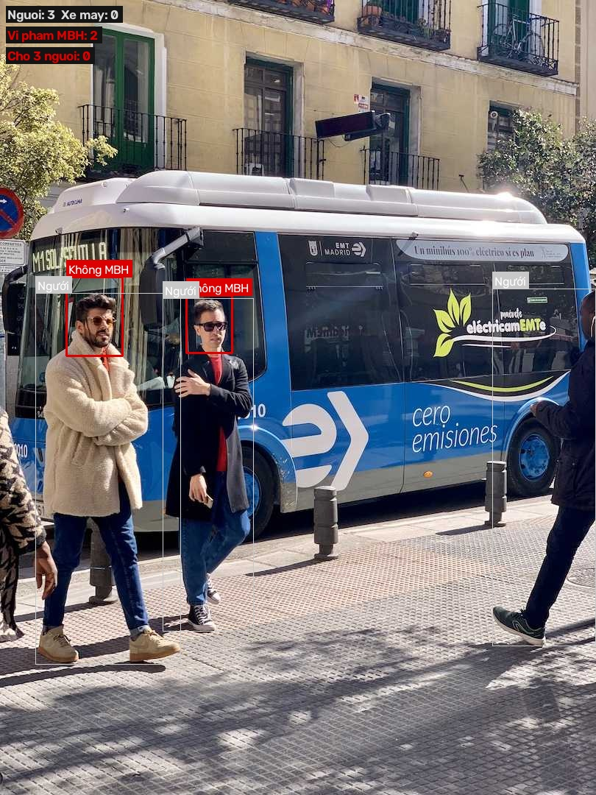

# CHƯƠNG V: KẾT QUẢ THỰC HIỆN

Chương này trình bày các kết quả đã xây dựng trong hệ thống AI Traffic Violation, gồm đánh giá mô hình AI, giao diện dashboard, phân tích ảnh/video, quản lý lịch sử và xử lý hồ sơ vi phạm. Các ảnh chụp giao diện cần được bổ sung từ lần chạy thực tế của ứng dụng. Không sử dụng ảnh minh họa giao diện mẫu hoặc số liệu dự đoán chưa được kiểm chứng thay cho kết quả thực nghiệm.

## 5.1. Kết quả đánh giá mô hình AI

### 5.1.1. Mục tiêu và phạm vi đánh giá

Hệ thống hiện kết hợp nhiều thành phần xử lý khác nhau: mô hình YOLO COCO phát hiện đối tượng phổ biến, mô hình YOLO tùy chỉnh phát hiện trạng thái mũ bảo hiểm, các heuristic hình học để ghép người với xe máy, xử lý màu đèn và vị trí đường dừng bằng OpenCV, cùng EasyOCR để hỗ trợ nhận dạng biển số. Vì vậy, kết quả đánh giá mô hình mũ bảo hiểm không đại diện cho độ chính xác của toàn bộ hệ thống.

Trong phạm vi project, dữ liệu có thông tin cụ thể để huấn luyện là tập phát hiện mũ bảo hiểm gồm hai lớp `With Helmet` và `Without Helmet`. Các chức năng chở quá số người, vượt đèn đỏ và nhận dạng biển số hiện sử dụng kết hợp mô hình phát hiện đối tượng, xử lý ảnh và luật suy luận; chưa có báo cáo đánh giá định lượng riêng được xác minh cho các chức năng này.

### 5.1.2. Dữ liệu thực nghiệm

Tập dữ liệu sử dụng là **Helmet Detection_YOLOv8 – With and Without Helmet**, phiên bản 3, xuất từ Roboflow ngày 10/12/2023. README ghi nhận tổng cộng 4.169 ảnh, nhãn YOLO với hai lớp. Dataset YAML phân chia dữ liệu thành train, validation và test; số lượng ảnh, nhãn theo lớp và chất lượng tệp nhãn dưới đây lấy từ `metrics_report.json` của lần đánh giá cuối.

| Split | Số ảnh | `With Helmet` | `Without Helmet` | Tổng annotation hợp lệ | Tệp nhãn rỗng | Annotation trùng |
|---|---:|---:|---:|---:|---:|---:|
| Train | 3.648 | 3.729 | 3.771 | 7.500 | 13 | 0 |
| Validation | 372 | 338 | 322 | 660 | 1 | 0 |
| Test độc lập | 149 | 170 | 103 | 273 | 0 | 1 |
| **Tổng** | **4.169** | **4.237** | **4.196** | **8.433** | **14** | **1** |

Tổng annotation trong bảng là số annotation hợp lệ sau khi bỏ qua một annotation trùng được phát hiện trong split test. Ba split có tổng số ảnh bằng 4.169 như README dataset. Dữ liệu được auto-orient theo EXIF và resize về 640 × 640; metadata ghi augmentation gồm lật ngang với xác suất 50%, crop ngẫu nhiên 0–20%, thay đổi độ sáng ±25% và Gaussian blur 0–2,5 pixel. Giấy phép dataset ghi là CC BY 4.0.

Nguồn dataset: https://universe.roboflow.com/learning-evidence/helmet-detection_yolov8/dataset/3. Ảnh/video giao thông nhập từ Wikimedia hoặc các nguồn khác không được tính vào các split trên và không được xem là ground truth nếu chưa được gán nhãn chuẩn.

### 5.1.3. Thiết lập huấn luyện và đánh giá

Thông số huấn luyện thực tế được đối chiếu từ `runs/detect/train-3/args.yaml` và `results.csv`; môi trường và thông tin lần đánh giá lấy từ `runs/detect/internship-final-evaluation-20261024-015234/metrics_report.json`. Cần phân biệt lần huấn luyện mô hình với lần chạy đánh giá: báo cáo đánh giá có `run_type` là `evaluation_only`, nghĩa là lần chạy này chỉ đánh giá checkpoint, không huấn luyện lại.

| Hạng mục | Thiết lập/kết quả đã ghi nhận | Nguồn |
|---|---|---|
| Mô hình và bài toán | Ultralytics YOLO, object detection cho hai lớp mũ bảo hiểm | `train-3/args.yaml`, `data.yaml` |
| Dataset | `datasets/helmet/data.yaml`; train/val/test | `metrics_report.json` |
| Số epoch huấn luyện | 50 epoch; `results.csv` có các epoch 47–50 | `train-3/results.csv` |
| Kích thước ảnh | 640 × 640 | `train-3/args.yaml` |
| Batch size | 8 | `train-3/args.yaml` |
| Seed và tính xác định | Seed 0; deterministic bật | `train-3/args.yaml` |
| Early stopping patience | 100 | `train-3/args.yaml` |
| Optimizer | `auto` (Ultralytics tự chọn) | `train-3/args.yaml` |
| Trạng thái resume | Có resume từ `runs/detect/train-3/weights/last.pt` | `train-3/args.yaml` |
| Checkpoint được đánh giá | `runs/detect/train-3/weights/best.pt` | `metrics_report.json` |
| Loại lần đánh giá | Evaluation-only; đánh giá cả validation và test | `metrics_report.json` |
| Thời điểm tạo báo cáo | 2026-10-24 01:52:34 UTC | `created_at` trong `metrics_report.json` |
| Python | 3.11.9 | `metrics_report.json` |
| Ultralytics | 8.4.123 | `metrics_report.json` |
| PyTorch | 2.11.0+cu128 | `metrics_report.json` |
| Hệ điều hành | Windows 10, build 26300 | `metrics_report.json` |
| Thiết bị đánh giá | CUDA device 0 — NVIDIA GeForce RTX 4050 Laptop GPU | `metrics_report.json` |

Tệp `args.yaml` ghi checkpoint `last.pt` là nguồn resume của lần huấn luyện; báo cáo đánh giá cuối dùng checkpoint `best.pt`. Báo cáo evaluation-only không lưu batch size và image size riêng cho lệnh đánh giá; giá trị 640 và batch 8 ở bảng là từ cấu hình huấn luyện, không khẳng định độc lập các tham số đánh giá không được ghi lại. Các giá trị mặc định của `train.py` có thể khác cấu hình thực tế trong `train-3/args.yaml`, do đó bảng này ưu tiên thông tin đã lưu từ lần chạy.

### 5.1.4. Chỉ số và kết quả đánh giá

Kết quả dưới đây lấy từ báo cáo đánh giá cuối của checkpoint `best.pt`. Precision và Recall phản ánh chất lượng phát hiện theo ngưỡng đánh giá của Ultralytics. mAP@0.5 là mean Average Precision tại IoU 0,5; mAP@0.5:0.95 là mAP trung bình trên các ngưỡng IoU từ 0,5 đến 0,95. Giá trị phần trăm được làm tròn hai chữ số từ số liệu trong JSON.

| Split | Số ảnh | Precision | Recall | mAP@0.5 | mAP@0.5:0.95 |
|---|---:|---:|---:|---:|---:|
| Validation | 372 | 85,96% | 90,48% | 93,45% | 58,96% |
| Test độc lập | 149 | 83,96% | 88,42% | 91,94% | 57,73% |

Thời gian xử lý trung bình theo từng giai đoạn được ghi trong cùng báo cáo, tính bằng mili giây trên mỗi ảnh:

| Split | Tiền xử lý | Inference | Hậu xử lý | Tổng ba giai đoạn |
|---|---:|---:|---:|---:|
| Validation | 2,67 ms | 5,66 ms | 2,51 ms | 10,84 ms |
| Test độc lập | 2,11 ms | 6,94 ms | 2,14 ms | 11,19 ms |

Tổng thời gian ở bảng là phép cộng tiền xử lý, inference và hậu xử lý trong báo cáo; không bao gồm trường `loss` gần bằng 0. Thời gian đo trên NVIDIA GeForce RTX 4050 Laptop GPU và có thể thay đổi theo phần cứng, kích thước batch, phiên bản thư viện và điều kiện chạy.

**Nhận xét kết quả:** Trên test độc lập, mô hình đạt Precision 83,96%, Recall 88,42%, mAP@0.5 91,94% và mAP@0.5:0.95 57,73%. So với validation, các chỉ số test thấp hơn lần lượt khoảng 2,00, 2,06, 1,51 và 1,23 điểm phần trăm. Khoảng cách giữa mAP@0.5 và mAP@0.5:0.95 cho thấy kết quả phụ thuộc vào độ nghiêm ngặt của ngưỡng IoU; cần xem thêm đường cong và confusion matrix khi phân tích localization/nhầm lẫn. Đây là kết quả của detector mũ bảo hiểm trên dataset đã nêu, không đại diện cho độ chính xác toàn bộ hệ thống hoặc các heuristic phát hiện vượt đèn đỏ, chở quá người và OCR.

### 5.1.5. Minh họa kết quả phân tích ảnh

Ảnh dưới đây là một tệp kết quả chú thích có sẵn trong thư mục `backend/results` của project. Ảnh hiển thị nhãn bounding box do pipeline phân tích tạo ra, trong đó phần thống kê trên ảnh ghi nhận hai phát hiện “Không MBH”. Đây là ví dụ minh họa một kết quả chạy, không phải đánh giá độ chính xác tổng thể và không thay thế ground truth.

**Hình 5.1.** Ví dụ kết quả ảnh sau khi hệ thống gắn nhãn và bounding box. Khi đưa vào báo cáo chính thức, cần xác nhận ảnh này thuộc lần chạy muốn trình bày, giữ nguồn dữ liệu và tránh để lộ thông tin cá nhân không cần thiết.

### 5.1.6. Đánh giá định tính và giới hạn

Kết quả hiện có cho thấy pipeline có thể nhận ảnh và trả ảnh chú thích cùng summary; các loại kết quả gồm không đội mũ bảo hiểm, chở quá số người và vượt đèn đỏ khi tùy chọn vạch dừng được bật. Video được xử lý nền theo frame được lấy mẫu và các phát hiện gần nhau được gộp thành sự kiện gần đúng.

Đánh giá định tính từ một vài ảnh không đủ để xác định độ chính xác. Chất lượng còn phụ thuộc vào độ phân giải, góc nhìn, ánh sáng, độ che khuất và cấu hình camera. Logic đèn đỏ/vạch dừng là heuristic; ghép người với xe máy được tính theo hình học; gộp sự kiện video không phải tracking ID liên tục; OCR có thể đọc sai hoặc không đọc được biển số. Vì vậy, các phát hiện cần được người có thẩm quyền đối chiếu bằng chứng trước khi xác nhận hồ sơ.

## 5.2. Trang Dashboard tổng quan

Dashboard cung cấp cái nhìn tổng hợp về dữ liệu hệ thống, gồm tổng số video, tổng số hồ sơ vi phạm và số lượng theo từng nhóm vi phạm. Trang còn có biểu đồ xu hướng theo ngày/tuần với bộ lọc khoảng thời gian, bảng vi phạm gần đây và bảng các lượt phân tích ảnh gần đây.

Các lượt phân tích ảnh được hiển thị riêng với hồ sơ vi phạm. Một ảnh vẫn có lịch sử phân tích ngay cả khi AI không ghi nhận vi phạm; trong trường hợp đó, số vi phạm bằng 0 và ảnh không xuất hiện thành hồ sơ trong danh sách xử lý vi phạm.

**[Chèn ảnh chụp giao diện Dashboard sau khi đăng nhập và dữ liệu đã tải thành công]**

**Hình 5.2.** Dashboard tổng quan của hệ thống AI Traffic Violation.

Khi chụp hình, cần thể hiện rõ các thẻ thống kê, bộ lọc ngày của biểu đồ và ít nhất một hàng dữ liệu thật nếu môi trường có dữ liệu. Nếu chưa có vi phạm, có thể giữ thông báo “chưa ghi nhận” và chụp bảng lượt phân tích ảnh riêng; không tạo dữ liệu giả để làm đầy giao diện.

## 5.3. Trang phân tích vi phạm bằng AI

Trang phân tích cho phép người dùng chọn ảnh hoặc video, xem trước tệp, thiết lập mã camera và bật/tắt kiểm tra vạch dừng. Với video, người dùng có thể cấu hình frame skip. Sau khi gửi yêu cầu, giao diện hiển thị kết quả ảnh/video đã chú thích, thống kê tổng số phát hiện, phân loại vi phạm và biển số đọc được nếu có.

Với ảnh, backend thực hiện phân tích trong yêu cầu và lưu bản gốc, bản chú thích, lịch sử phân tích cùng các vi phạm phát hiện được. Với video, API tiếp nhận tệp và tạo công việc chờ; video worker thực hiện phân tích nền, cập nhật tiến độ và lưu kết quả.

**[Chèn ảnh chụp trang phân tích ảnh: ảnh đã chọn, tùy chọn vạch dừng và kết quả thật sau khi chạy]**

**Hình 5.3.** Giao diện phân tích ảnh và hiển thị kết quả nhận diện.

**[Chèn ảnh chụp trang phân tích video khi có một job xử lý thực tế]**

**Hình 5.4.** Giao diện theo dõi quá trình xử lý video và kết quả.

Nếu chưa có ảnh/video mẫu được kiểm thử hoặc job video hoàn tất, chỉ đưa ảnh giao diện và ghi rõ đây là màn hình chức năng; không mô tả là kết quả phát hiện thành công.

## 5.4. Trang quản lý video giám sát

Trang quản lý video trình bày danh sách video đã gửi, trạng thái (`pending`, `processing`, `processed`, `error`), tiến độ nếu đang xử lý, số vi phạm và thời điểm tải lên. Admin có thể xóa video; khi worker hoàn tất, người dùng có thể mở video chú thích nếu kết quả được lưu thành công.

Để minh họa đầy đủ quy trình, nên chụp một video ở trạng thái hoàn tất và một kết quả video đã chú thích. Nếu chỉ có trạng thái chờ/lỗi, cần ghi rõ điều kiện đó, ví dụ worker chưa chạy, thay vì trình bày như video đã phân tích xong.

**[Chèn ảnh chụp danh sách video có trạng thái và tiến độ từ lần chạy thực tế]**

**Hình 5.5.** Danh sách và trạng thái xử lý video giám sát.

## 5.5. Trang lịch sử phân tích ảnh và bằng chứng

Trang lịch sử liệt kê các lần phân tích ảnh theo tài khoản, hỗ trợ lọc ngày và mở bằng chứng. Viewer xem các bản ghi do mình sở hữu; admin có thể xem lịch sử toàn hệ thống. Khi mở một bản ghi, hệ thống hiển thị ảnh gốc, ảnh đã chú thích, thời điểm phân tích, cấu hình vạch dừng và danh sách vi phạm liên quan.

**[Chèn ảnh chụp bảng lịch sử có một hoặc nhiều bản ghi thực tế]**

**Hình 5.6.** Trang lịch sử phân tích ảnh.

**[Chèn ảnh chụp hộp thoại chi tiết gồm ảnh gốc và ảnh đã chú thích]**

**Hình 5.7.** Bằng chứng của một lần phân tích ảnh.

Ảnh minh họa cần sử dụng dữ liệu được phép đưa vào báo cáo. Nên che hoặc làm mờ biển số, khuôn mặt hay thông tin nhận dạng cá nhân nếu không cần thiết cho mục đích trình bày.

## 5.6. Trang xử lý vi phạm

Trang xử lý vi phạm hiển thị các hồ sơ được tạo khi hệ thống phát hiện sự kiện. Mỗi hồ sơ có loại vi phạm, confidence, biển số nếu nhận dạng được, nguồn phát sinh, trạng thái duyệt và hành động tương ứng. Admin có thể mở báo cáo bằng chứng, cập nhật biển số/ghi chú, duyệt (`approved`), từ chối (`rejected`) hoặc để chờ (`pending`). Viewer chỉ có quyền xem.

Hồ sơ vi phạm chỉ được tạo khi có phát hiện tương ứng; lượt phân tích ảnh không có vi phạm không tạo hồ sơ xử lý. Vì vậy, nếu bảng trống trong khi lịch sử phân tích có dữ liệu với số vi phạm bằng 0, đó là hai loại dữ liệu khác nhau chứ không nhất thiết là lỗi truy vấn.

**[Chèn ảnh chụp danh sách hồ sơ vi phạm thật; nếu chưa có hồ sơ, chụp thông báo trạng thái trống và bảng lịch sử ảnh ở mục 5.5]**

**Hình 5.8.** Trang xử lý và duyệt hồ sơ vi phạm.

**[Chèn ảnh chụp báo cáo một hồ sơ có bằng chứng và thông tin đã được ẩn danh phù hợp]**

**Hình 5.9.** Báo cáo bằng chứng phục vụ kiểm tra hồ sơ.

Không sử dụng hồ sơ nhân tạo hoặc tự sửa database để tạo hình minh họa. Nếu dữ liệu thực nghiệm chưa tạo ra vi phạm, trình bày trung thực trạng thái trống và nêu rõ chưa có hồ sơ phát sinh từ lần chạy đó.

## 5.7. Trang nhật ký hoạt động và kết quả kiểm thử chức năng

### 5.7.1. Nhật ký hoạt động quản trị

Nhật ký hoạt động dành cho admin, ghi nhận các thao tác như tạo quản trị viên, cập nhật cấu hình camera, hoàn tất phân tích ảnh, đưa video vào hàng đợi, cập nhật duyệt vi phạm và xóa tài nguyên. Giao diện trình bày thời gian, người thực hiện, tên hành động, đối tượng và chi tiết bằng nhãn dễ đọc.

**[Chèn ảnh chụp nhật ký hoạt động sau khi có các thao tác thực tế]**

**Hình 5.10.** Trang nhật ký hoạt động quản trị.

### 5.7.2. Bảng kiểm thử chức năng

Bảng dưới đây là mẫu ghi nhận kiểm thử thủ công. Chỉ đánh dấu “Đạt” sau khi thực hiện và quan sát kết quả trên đúng phiên bản hệ thống; nếu chưa kiểm thử, ghi “Chưa kiểm thử”.

| STT | Chức năng | Dữ liệu/điều kiện kiểm thử | Kết quả mong đợi | Kết quả thực tế |
|---:|---|---|---|---|
| 1 | Đăng nhập | Tài khoản hợp lệ trong Supabase Auth | Tạo phiên và hiển thị giao diện theo role | [Đạt/Không đạt/Chưa kiểm thử] |
| 2 | Phân quyền | Viewer truy cập chức năng admin | Backend từ chối thao tác trái quyền | [Đạt/Không đạt/Chưa kiểm thử] |
| 3 | Phân tích ảnh | Ảnh giao thông hợp lệ | Trả ảnh chú thích và lưu lịch sử | [Đạt/Không đạt/Chưa kiểm thử] |
| 4 | Bật/tắt vạch dừng | Cùng ảnh, lần lượt bật và tắt tùy chọn | Chỉ chạy logic vạch dừng khi được bật | [Đạt/Không đạt/Chưa kiểm thử] |
| 5 | Phân tích video | Video hợp lệ và worker hoạt động | Tạo job, cập nhật tiến độ, lưu kết quả cuối | [Đạt/Không đạt/Chưa kiểm thử] |
| 6 | Lịch sử ảnh | Viewer và admin đăng nhập | Viewer chỉ thấy bản ghi của mình; admin xem toàn hệ thống | [Đạt/Không đạt/Chưa kiểm thử] |
| 7 | Duyệt vi phạm | Admin cập nhật trạng thái và ghi chú | Lưu thay đổi và ghi audit log | [Đạt/Không đạt/Chưa kiểm thử] |
| 8 | Bằng chứng riêng tư | Người đã đăng nhập mở báo cáo | Tạo signed URL tạm thời cho bằng chứng được phép xem | [Đạt/Không đạt/Chưa kiểm thử] |

### 5.7.3. Nhận xét tổng hợp

Hệ thống đã xây dựng được luồng tích hợp từ giao diện web, API, mô-đun AI, lưu trữ dữ liệu đến các trang tra cứu và duyệt kết quả. Phân tích ảnh có thể lưu lịch sử và bằng chứng; xử lý video được tách thành worker nền; vai trò viewer/admin phân biệt quyền xem và quyền quản trị. Các chức năng này tạo thành nền tảng thử nghiệm cho quy trình hỗ trợ phát hiện và rà soát vi phạm giao thông.

Kết quả định lượng của mô hình và kết quả kiểm thử chức năng cần được hoàn thiện từ các lần chạy thực tế theo bảng ở mục 5.1 và 5.7.2. Khi chưa có metrics hoặc biên bản kiểm thử, báo cáo chỉ nên trình bày các tính năng đã xác nhận và ví dụ minh họa, không kết luận về độ chính xác hoặc hiệu năng vượt quá bằng chứng hiện có.

## Danh sách hình dự kiến

| Số hình | Nội dung |
|---|---|
| Hình 5.1 | Ví dụ ảnh được AI phân tích và gắn nhãn |
| Hình 5.2 | Dashboard tổng quan |
| Hình 5.3 | Phân tích ảnh và kết quả |
| Hình 5.4 | Tiến độ/kết quả xử lý video |
| Hình 5.5 | Danh sách video |
| Hình 5.6 | Lịch sử phân tích ảnh |
| Hình 5.7 | Chi tiết bằng chứng ảnh |
| Hình 5.8 | Trang xử lý vi phạm |
| Hình 5.9 | Báo cáo bằng chứng vi phạm |
| Hình 5.10 | Nhật ký hoạt động |

> **Việc cần hoàn thiện trước khi nộp:** Điền kết quả từ `metrics_report.json`; ghi phiên bản phần mềm/phần cứng thực nghiệm; chạy và ghi nhận các ca kiểm thử; thay các dòng `[Chèn ảnh chụp ...]` bằng ảnh chụp giao diện từ bản chạy thật; đánh số hình/bảng thống nhất với toàn bộ báo cáo.
